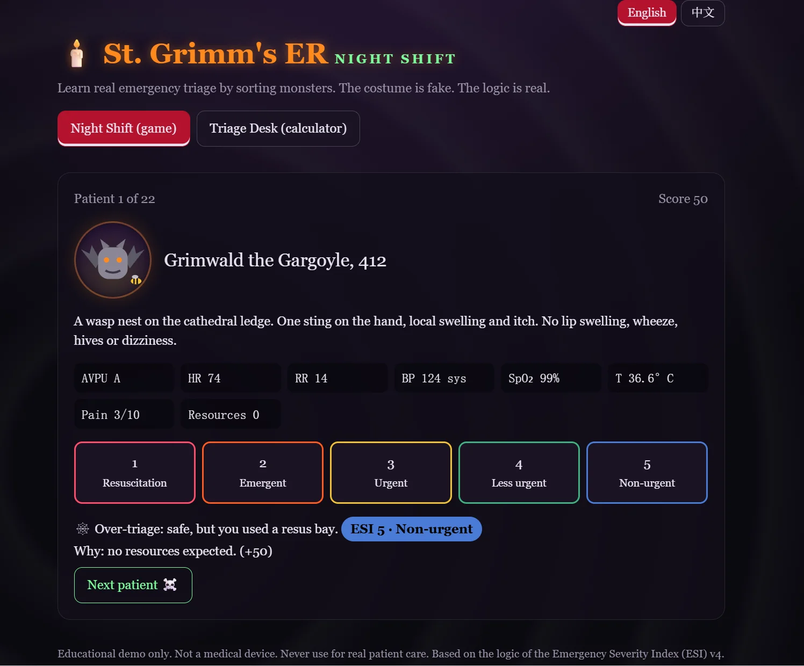

# 🕯️ Grimm Triage — Night Shift at St. Grimm's ER

Learn real emergency-department triage by sorting monsters. The costume is fake. The logic is real.

**▶ Live demo: [grimm-triage.vercel.app](https://grimm-triage.vercel.app/)**

**Kiroween 2026 · Costume Contest** · Built with [Kiro](https://kiro.dev) by an emergency physician.

> ⚠️ Educational demo only. Not a medical device. Never use for real patient care.

## What it does
- **Night Shift (game):** a vampire with a bleeding fang, a dehydrated mummy, an unresponsive ghost… pick the triage level, get instant feedback with the exact rule that fired. Under-triage costs extra, because that is the dangerous mistake in a real ED. Each night draws 15 monsters (3 per ESI level, none from the previous night), with vital signs and opening lines that vary on every replay. The bank has 71 cases: 61 regular monsters and 10 storyline patients.
- **Storylines:** on about half of nights, two patients from the same incident arrive a few patients apart, and the second card says so ("same incident as patient 10"). There are 5 storylines, such as a Moonlight Brawl between an apologetic werewolf and a vampire who insists on queueing with a stake in his chest, or a Cauldron Hut where a pulse oximeter reads normal in carbon monoxide poisoning. The shift report ends the story with a teaching point: triage the patient in front of you, not the story.
- **Triage Desk (calculator):** type vital signs and flags, get an ESI v4-style level with reasons and danger-zone warnings.

## Screenshots
| Triage board | Haunting effect (under-triage) | Shift report |
|---|---|---|
|  |  |  |

## Run locally
```bash
npm install
npm test        # unit + property-based tests
npm start       # serves the static site
```

## Recording the demo
A dev-only Playwright script plays one night by itself and records the real app for the video.
```bash
npm install
npx playwright install chromium   # once
npm start                         # terminal 1: http://localhost:3000
npm run demo:record               # terminal 2; or: npm run demo:record -- --url <url> [--seed 87]
```
It opens the app with `?seed=87` (a fixed night with The Sandman as patient 4), triages three patients correctly, under-triages The Sandman so the haunting effect plays, fast-forwards through the rest of the night, shows the shift report and lesson, gets a provisional ESI 2 on the Triage Desk with HR, RR and SpO₂ missing, and switches to 中文 for 3 s. Every answer comes from `src/triage.js`, never a hard-coded list.

Output in `demo-output/` (git-ignored): `demo.webm` (1280x720, no audio track: Playwright records video only) and `timeline.json` with each shot's `name`, `start` and `end` in seconds from the start of the video, for subtitles and voice-over. Cut the `fast-forward` shot in editing. Record on a machine with Chinese and emoji fonts installed, or those characters show as boxes.

Without `?seed=` the app draws a random night exactly as before.

## Offline (PWA)
After the first visit the game and calculator work with no network: `sw.js` precaches `index.html`, `styles.css`, the manifest, icons and every file in `src/`. It can be installed to a home screen (`manifest.webmanifest`). All paths are relative, so it works at a domain root (Vercel) or in a sub-folder.

When you change any precached file, bump `CACHE_VERSION` in `sw.js`; the new worker installs a fresh cache and deletes the old one on activate. Adding a file to `src/` without listing it in `PRECACHE_URLS` fails `npm test`.

## Privacy
The live site counts visits with [Umami Cloud](https://umami.is), a privacy-friendly analytics service. It sets no cookies and stores no personal data.
- **Counted:** page views, country or region, time on site, referrer, and device, browser and OS type. Plus four anonymous game events, one small value each:

  | Event | Property | Example |
  |---|---|---|
  | `night-complete` | `score` when the shift report opens | `1150` |
  | `under-triage` | `step`: the ESI decision point (A–D) of the missed case | `D` |
  | `desk-submit` | `level`: the computed Triage Desk level, `P` when provisional | `2P` |
  | `lang-switch` | `lang` | `zh-CN` |
- **Never sent:** ages, vital signs, case or monster names, free text, or anything typed into the Triage Desk. `src/analytics.js` drops any other property and `test/analytics.test.js` checks it.
- **Not counted:** localhost and preview deploys (`data-domains`), browsers with Do Not Track on, and demo recordings (`?seed=`; the recorder also blocks the script).
- **Optional:** if the script is blocked (ad blockers, some networks) or you are offline, the app works exactly the same. The service worker never caches it.

## Accessibility
Target: WCAG 2.2 AA, in English and 中文.
- Every text colour, ESI badge and level-button outline meets AA contrast (`test/a11y.test.js` checks the theme tokens).
- One visible 3px focus ring; logical focus order: skip link → language → mode → level buttons → *Next patient* → the next patient card.
- The whole game, shift report and calculator work with the keyboard alone (Tab, Enter, Space).
- Buttons, inputs, portraits, landmarks and the `role="status"` feedback regions all have translated labels.
- Checked with axe-core 4.10.2 in headless Chromium in both languages, with and without reduced motion, across a full night of cases, the shift report and the calculator: 0 violations.

## Maintenance
- YouTube statistics for the demo video are recorded every 3 hours by `.github/workflows/youtube-stats.yml` into `data/youtube-stats.json` on the branch `stats` ([raw JSON](https://raw.githubusercontent.com/lqingsheng/grimm-triage/stats/data/youtube-stats.json)); the API key is the repository secret `YOUTUBE_API_KEY`.

## How Kiro was used
- **Spec-driven development:** `.kiro/specs/haunted-er-triage/` (EARS requirements → design → tasks).
- **Steering:** product, tech, structure, and a file-scoped `clinical-safety.md` that loads only when the engine is edited.
- **Agent hooks:** run tests on engine change, review new monster cases for clinical coherence, costume + accessibility check on UI edits.
- **Property-based testing:** fast-check properties encode safety rules (e.g. a worse finding never makes a patient less urgent).
- _(Fill in as you build: what the spec changed vs vibe coding, any MCP or powers used.)_

## License
MIT
